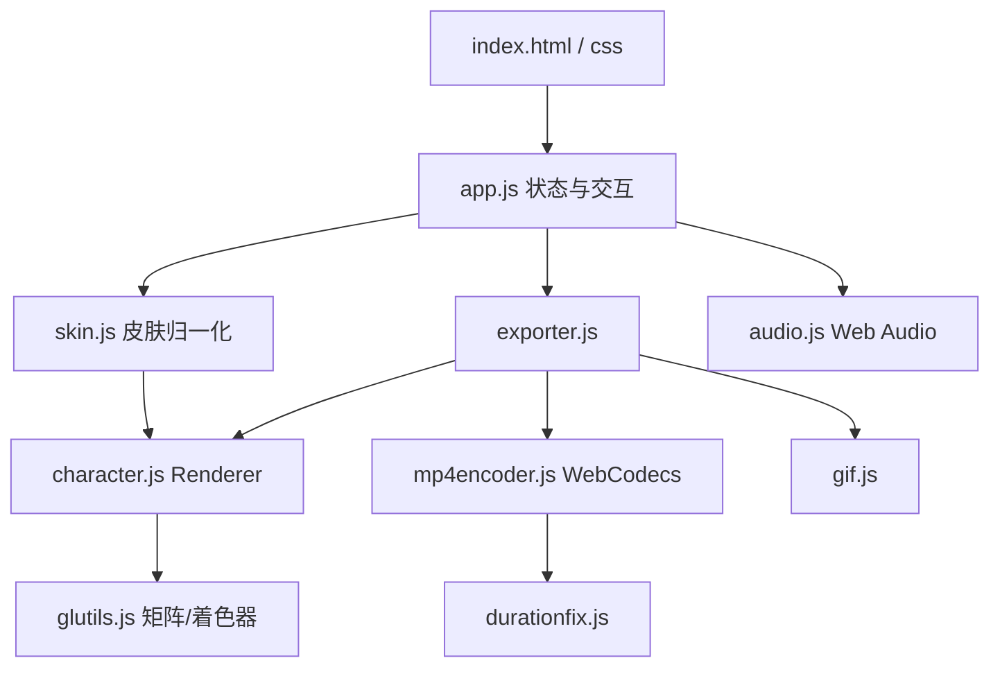
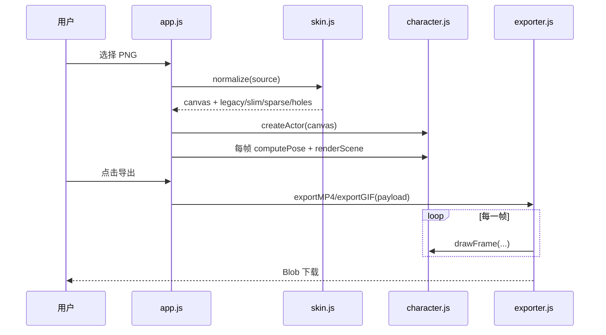

# 开发文档

项目：我的弹跳玩偶（MineDoll） · 我的世界皮肤玩偶动画生成器

面向要改功能、加动作、加导出格式的开发者。使用说明见 [README](../README.md)。

- 技术栈：原生 WebGL + Web Audio + WebCodecs，无框架、无打包器、无第三方依赖
- 代码组织：ES5 风格的 IIFE 模块，按职能挂到 `window` 下的全局对象
- 发布形态：根目录多文件版 + `toy/index.html` 单文件版（由脚本构建）

## 环境与构建

```bash
# 本地调试（推荐 localhost，WebCodecs 需要安全上下文）
python -m http.server 8000

# 生成 Toy 单文件版
python build-toy.py
```

`build-toy.py` 会读取 `index.html`，把 `<link rel="stylesheet" href="css/style.css">` 与所有 `<script src="..."></script>` 的内容内联，输出 `toy/index.html`。

- `toy/index.html` 是构建产物，**不要手改**
- 新增 JS 文件只要在 `index.html` 里用 `<script src>` 引用，就会被自动内联
- 构建后检查：`toy/index.html` 里不应残留 `<script src=`

## 目录结构

```
.
├─ index.html            页面骨架：画框、工具栏、二级面板、导出 / 版权弹窗
├─ css/style.css         白色主题、固定比例画框、两行 dock、移动端适配
├─ js/
│  ├─ glutils.js         列主序矩阵工具 M4、着色器编译、纹理上传
│  ├─ skin.js            皮肤识别与归一化（版本 / 倍率 / 纤细 / 镂空）
│  ├─ character.js       盒体网格、WebGL 渲染器、姿态、环形布局、取景距离
│  ├─ exporter.js        导出编排：逐帧绘制 + MP4 / GIF，降级路径
│  ├─ mp4encoder.js      WebCodecs H.264 + 手写 MP4 封装（含 ctts）
│  ├─ gif.js             GIF89a 编码器（LZW、调色板、循环块）
│  ├─ durationfix.js     修补 WebM / MP4 容器时长（播放器读不到时长）
│  ├─ audio.js           Web Audio 合成背景音乐 + 本地音频导入
│  ├─ presets.js         内置皮肤清单
│  └─ app.js             状态机、交互绑定、渲染循环、导出参数组装
├─ build-toy.py          把多文件版内联成 toy/index.html
├─ _make_versions.py     一次性脚本：把原始皮肤转成 64×32 / 64×64 / 纤细三份样例
├─ toy/index.html        Toy 发布产物（构建生成）
├─ LICENSE               MIT + 免责 NOTICE
└─ 233-*.png             默认皮肤不同格式的转换样例
```

## 架构



渲染与导出的数据流：



## 模块 API 速查

挂载在 `window` 上的全局对象：

| 模块 | 关键 API |
| --- | --- |
| `GLUtil` | `M4.identity/multiply/chain/translation/scaling/rotationX/Y/Z/perspective/lookAt/normalMat3`、`createProgram`、`createTexture` |
| `Skin` | `normalize(source)` → `{canvas,width,height,legacy,slim,sparse,holes}`、`createDefaultSkin()` |
| `Skin3D` | `new Renderer(canvas,{antialias})`、`createActor(canvas)`、`deleteActor(actor)`、`setViewport(w,h)`、`renderScene(scene,projection,view)`、`computePose(options)`、`computeLayout(count,selectedIndex,order)`、`framingDistance(totalHeight,count,aspect)` |
| `SkinExporter` | `supportsMP4()`、`exportMP4(options)`、`exportGIF(options)` |
| `SkinMp4` | `supported()`、`encode({canvas,width,height,fps,bitrate,duration,render(t)})` |
| `SkinDuration` | `fix(blob, ext, duration)` |
| `SkinAudio` | `toggle/play/stop/setFile/clearFile/isPlaying/source/label`、`onState` 回调 |

`exportMP4/exportGIF` 的 `options`（由 `app.js` 组装，导出逻辑与 UI 解耦）：

```js
{
  models: [{ canvas, slim, sparse }],
  fill: 'auto' | 'black' | 'white' | 'none',
  selectedIndex, order, cycle, spin, loop, duration,
  aspect, width, height, fps, bitrate, qualityLabel,
  distance, targetY,          // 与预览一致的相机
  overlay, doll, sitting, bounce,
  yaw, pitch,
  background: 'white' | 'transparent' | 'image',
  backgroundImage,
  onProgress(ratio, label)
}
```

## 关键约定

**皮肤 UV**：`character.js` 顶部的 `PART_DEFS` 是 64×64 布局的单一事实来源（头 / 身 / 双臂 / 双腿的 `u,v,tw,th,td`）。改 UV 只改这张表。

**UV 内缩 0.5 个纹素**：`buildBoxData` 的 `inset = 0.5`。开 MSAA 后，面边缘的像素会把 UV 外推到相邻贴图区域，内缩不足会出现点状接缝；不要改回 `0.02`。

**坐标与尺寸**：1 个世界单位 = 皮肤 1 像素。头 8×8×8，身体 8×12×4，四肢 4×12×4（纤细 3×12×4）。模型脚底在 `y = 0`。

**动画时间**：120 BPM，`BEAT_SECONDS = 0.5`。弹跳用余弦包络（两端速度为 0），再叠一阶指数平滑；单模型旋转 `dt * π/2` = 8 拍 / 4 秒一圈。

**导出与预览一致**：`payload.distance / targetY / yaw / pitch` 直接取当前相机，导出侧不要自己重新取景（GIF 固定 480×480 正方形是唯一的例外）。

**场景结构**：`renderScene(scene, projection, view)` 的 `scene = { actors, shadows, overlay }`，每个 actor 是 `{ actor, pose, model, slim, fill }`。

## 扩展指南

### 1. 新增一种导出格式

1. 在 `exporter.js` 里复用 `frameSettings(options)` 与 `drawFrame(...)` 逐帧绘制；
2. 导出新的 `exportXXX(options)` 并挂到 `SkinExporter`；
3. 在 `index.html` 的导出弹窗加按钮，`app.js` 的 `runExport(format)` 增加分支。

注意：离线导出依赖 `WebCodecs` 或纯 JS 编码器，不要依赖实时录制（掉帧）。

### 2. 新增动作 / 姿态（挥手、走路、鞠躬）

1. `character.js` 的 `computePose(options)` 里加参数（参考 `sitT`、`squash`）并生成对应矩阵；
2. `app.js` 的 `state`、渲染循环 `lastPose`、`buildScene()` 里透传；
3. 导出参数补进 `app.js` 的 `payload`，并在 `exporter.js` 的 `frameSettings` 中使用；
4. 新动作建议用 0→1 的插值参数，配合 `1 - Math.exp(-dt * k)` 平滑，避免突兀。

### 3. 新增皮肤格式 / 规则

只改 `skin.js` 的 `normalize()`：它接收任意 `Image` / `Canvas`，输出统一到 64×64 布局的画布，并声明 `legacy / slim / sparse / holes`。新规则要补一个样例 PNG，并在下面的自测清单里加一项。

### 4. 新增 UI 开关

1. `index.html` 放进第一行 dock、第二行选项或「更多设置」二级面板；
2. `css/style.css` 跟随现有 `.btn / .seg / .dock-group / .more-row` 写法，隐藏用 `hidden` 属性；
3. `app.js` 增加 DOM 引用、`state` 字段与事件绑定；
4. 如果影响导出，记得加进 `payload`。

窄屏（≤760px）下工具栏会自动换行，新增控件后请用 390×844 复查一遍。

### 5. 改背景音乐 / 节奏

`audio.js` 顶部的 `CHORDS`、`CHORUS_BARS`、`VERSE_BARS` 就是全部乐谱数据（`[起始十六分步, MIDI 音高, 持续步数]`）。改完注意：

- 弹跳仍按 120 BPM 对齐，换速度要同时改 `BEAT_SECONDS`；
- 播放开始会派发 `skinlab:musicstart`，`app.js` 用它把 `phys.beatClock` 归零。

### 6. 改环形布局

`character.js` 的 `ringPlan(count)`（内外圈分配）与 `computeLayout(count, selectedIndex, order)`（极坐标插值、旋转切换）是布局核心；`app.js` 只负责把 `ringOrder` / `cycle` 传进去。导出侧 `exporter.js` 的 `layoutFor` 必须与预览保持同一套顺序。

## 已知坑

- **不要直接改 `toy/index.html`**：所有改动写源码，跑 `python build-toy.py`。
- **新增 JS 文件**：只要在 `index.html` 里用 `<script src="...">` 引用，构建脚本会自动内联；漏引用会导致 Toy 版静默失效。
- **MP4 时长不对**：`MediaRecorder` 不写时长，`durationfix.js` 负责修补；WebCodecs 路径不需要。
- **B 帧导致的“看着掉帧”**：硬件编码器可能输出 B 帧，`mp4encoder.js` 会写 `ctts`；改动封装时不要删。
- **透明画布 + MSAA**：边缘像素会采样到相邻面的纹素，UV 必须内缩半个纹素。
- **`.btn` 会覆盖 `hidden`**：样式里已有 `[hidden] { display: none !important; }`，不要再删。
- **导出的画框比例**：横屏 16:9、竖屏 9:16，1:1 视为横屏；GIF 例外，固定 480×480。

## 自测清单

改完功能后至少过一遍：

- [ ] 64×64 标准皮肤、64×32 旧版、128×128 高清、Alex 纤细、镂空（冰焰类）
- [ ] 单模型 / 多模型、玩偶模式、坐下、弹跳、旋转
- [ ] 导出 MP4（1080P 与 4K）与 GIF，检查时长、循环、白色 / 镂空 / 背景图
- [ ] 桌面 1024×576 与手机 390×844 各截一张图，确认工具栏不溢出
- [ ] `python build-toy.py` 后，`toy/index.html` 里没有残留 `<script src=`
- [ ] 背景音乐开关、导入音频、切回默认旋律

## 贡献

- 代码风格：ES5 风格的 IIFE 模块，全局对象按 `Skin / Skin3D / SkinExporter / SkinAudio` 分组；不引入打包器。
- 提交前跑一次 `python build-toy.py`，确认单文件版可用。
- 大改动请同步更新本文档的目录结构、API 表与自测清单，以及 [README](../README.md) 里的使用说明。
